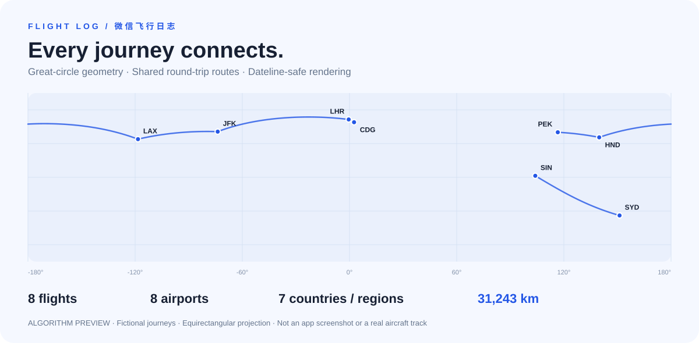

# 飞行日志 · Flight Log

**把个人飞行记录连成一张地图。** 使用微信原生小程序与 JavaScript 实现的个人项目，包含全球机场搜索、飞行记录管理、大圆航线动画与旅行统计；默认本地运行，也提供 CloudBase 云函数实现。



> 上图由项目的真实航线算法生成，是虚构示例数据的算法示意图，非小程序运行截图。路线与箭头表示理论大圆路径和方向，不代表真实航迹或实时飞机位置。

[快速运行](#快速运行) · [架构与取舍](docs/ARCHITECTURE.md) · [演示与项目介绍](docs/PORTFOLIO.md) · [CloudBase 部署](docs/CLOUDBASE.md) · [公开上传步骤](docs/PUBLISHING.md)

## 项目解决什么问题

手动记录每次飞行后，统一查看“飞过哪里、走了多远、去过哪些机场和国家/地区”。项目围绕“搜索机场 → 预览航线 → 保存记录 → 地图回顾 → 查看统计”形成完整流程。

| 能力 | 实现 |
| --- | --- |
| 机场搜索 | 9,027 个机场；IATA / ICAO / 英文名称 / 城市 / 部分中文别名；300ms 防抖、最多 20 条结果 |
| 记录管理 | 新增、编辑、详情、单条删除、两次确认后清空；日期倒序与年份筛选 |
| 航线地图 | Haversine 距离、球面插值、32–128 段自适应采样、跨 ±180° 拆线 |
| 方向动画 | 原生 `moveAlong` 优先，兼容刷新回退；页面隐藏或卸载时停止循环 |
| 聚合与统计 | 往返共享几何路线，方向独立去重；飞行次数、公里、机场及国家/地区清单 |
| 数据模式 | 本地缓存可独立演示；CloudBase 通过服务端 OpenID 隔离用户记录 |

## 快速运行

**小程序体验：** 安装微信开发者工具，导入仓库根目录。公开配置使用 `touristappid`，默认 `USE_CLOUD: false`，无需开通云环境。测试 AppID 的地图及真机能力以开发者工具支持为准；完整地图/真机体验可改用自己的小程序 AppID，公开提交前恢复默认配置。

1. 打开 **“我的 → 体验示例旅程”**，添加 8 条明确标记为虚构的记录。
2. 打开 **“地图”**，查看北京往返东京，以及东京至洛杉矶的跨日期变更线航线。
3. 在 **“记录”** 切换 2025 / 2026，进入详情、编辑一条记录。
4. 在 **“我的”** 点击到访机场和国家/地区卡片，查看去重清单。

示例仅在本地模式、记录为空时可导入，不覆盖已有记录。代码首次运行不会自动写入示例。可从“我的”删除示例，再录入自己的旅程。

**代码验证：** 使用 Node.js 22+ 和 npm；前端无第三方框架，根项目无 npm 运行依赖。

```bash
npm ci
npm run verify
```

`verify` 执行公开配置/常见凭证模式检查、JS/JSON 校验和 10 个测试文件。云函数测试使用 SDK mock，不需要云账号。GitHub Actions 配置 Node.js 22 / 24 矩阵；微信原生组件效果仍需开发者工具/真机验证。

## 值得阅读的实现

| 设计问题 | 处理方式 | 代码入口 |
| --- | --- | --- |
| 跨太平洋航线横穿整张地图 | 球面插值后在日期变更线插入边界点并拆成多段 | [route.js](miniprogram/utils/route.js) |
| 多次乘坐同一航线造成叠绘 | 无向机场对复用几何，有向机场对保留方向；统计保留全部记录 | [地图页面](miniprogram/pages/map/index.js) |
| 动画流畅度与资源释放 | 优先原生路径动画，能力不足时回退；生命周期结束时取消循环 | [route-animation.js](miniprogram/utils/route-animation.js) |
| 机场源数据体积较大 | 紧凑行存储与按搜索页加载；其他页面读取记录中的机场快照 | [机场服务](miniprogram/services/airport.service.js) / [生成脚本](scripts/sync-airports.js) |
| 云端记录的归属与可信性 | 服务端取得 OpenID；更新/删除前校验归属；从机场库重新生成快照和距离 | [flightService](cloudfunctions/flightService/index.js) / [隔离测试](tests/cloud-flight.test.js) |

## 结构

```text
miniprogram/           微信原生页面、服务、航线算法与本地数据
cloudfunctions/       airportSearch / flightService，独立依赖锁文件
cloud-data/           机场导入数据（JSON Lines）与来源元数据
scripts/              数据同步、测试入口、公开检查、算法预览生成
tests/                搜索、数据完整性、航线、动画、CRUD、示例与云函数测试
docs/                 架构、产品范围、演示、开发、部署与公开上传说明
.github/              CI、Issue 与 PR 模板
```

## 范围与后续方向

当前是可演示的个人项目，未接入真实航班 API、实时状态或 ADS-B；没有线上用户量、生产性能或商业运行数据的声明。地图/记录列表当前最多加载 500 条，云端统计最多汇总 5,000 条；中文别名覆盖有限，本地缓存没有备份机制。

下一步可改进游标分页、统一两种模式的输入校验、数据导出，以及真实设备和云端集成验证。具体边界与取舍见 [架构文档](docs/ARCHITECTURE.md)，手动验收步骤见 [开发说明](docs/DEVELOPMENT.md)。

## 数据与许可证

代码采用 [MIT License](LICENSE)。机场数据来自 [OurAirports](https://ourairports.com/data/)，按其 Public Domain 条款再分发，当前快照生成于 **2026-08-24**；9,027 是快照数量，不是实时机场总数。来源、筛选规则与声明见 [THIRD_PARTY_DATA.md](THIRD_PARTY_DATA.md) 和 [部署与数据说明](docs/CLOUDBASE.md)。
