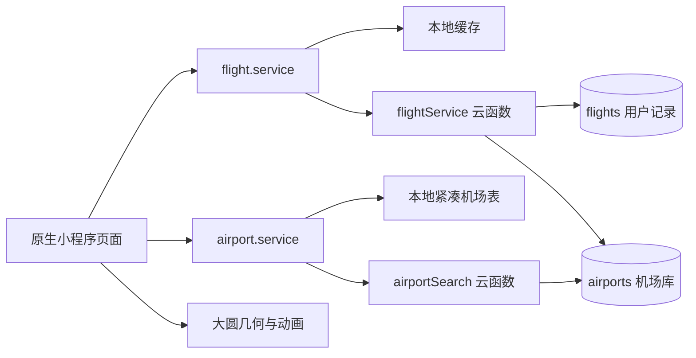

# 架构与技术取舍

项目使用微信原生小程序（WXML / WXSS / JavaScript）和两个可选 CloudBase 云函数。页面通过服务模块访问数据，不直接调用数据库。

## 数据边界

每条记录保存日期、航班号、机型、座位、备注、机场快照、距离及 `routeType` / `routeVersion`。快照使地图与统计页无需加载全球机场表，历史展示也不依赖机场名称的即时变化。云端编辑时按机场 ID 重新读取机场库，快照随编辑更新。

本地使用 `flight_log_records_v1` 缓存键。云端 `_openid` 只取自 `cloud.getWXContext()`，不接受客户端指定的所有者；读取、更新和删除都检查归属。服务端重算机场快照和距离，避免客户端坐标成为云端权威数据。规则与测试范围见 [部署说明](CLOUDBASE.md)。

## 航线与动画

理论大圆只需要两个坐标即可重建，避免依赖外部航迹 API。距离使用 Haversine 公式；路径在球面上插值，按距离使用 32 / 64 / 96 / 128 段采样。这是球形地球近似，不表达天气绕飞、空管调整或当天的实际飞行距离。

跨越 ±180° 时，经度会从接近 +180 跳到 −180，直接连线可能横穿整张投影地图。`splitAtDateline()` 在边界插点并输出多段 polyline；动画也按日期变更线拆分。测试包含 HND–LAX 双向案例。极端对跖点使用数值退化回退，不适合作为精密导航模型。

几何按排序后的机场对去重，方向按 `departure > arrival` 去重。因此多次同向飞行共用曲线与箭头，往返共用曲线但有两个方向箭头；次数和距离仍基于原始记录。

箭头优先使用原生 `moveAlong()`，不支持或调用失败时回退到自适应刷新。动画以 420 km/s 的视觉标尺在 8%–92% 区间循环，周期限制为 2.8–42 秒，不能解释为真实航班速度。页面隐藏/卸载会停止控制循环；已提交的原生动画短段仍受平台实现影响，需要设备验证。

## 数据规模与搜索取舍

提交机场快照使克隆后即可搜索。生成脚本输出小程序紧凑表、CloudBase JSON Lines 和来源元数据，测试验证数量、ID、字段与坐标。本地表约 1.2 MB、云导入文件约 4.2 MB；机场表仅由机场搜索服务加载，示例旅程自带少量快照。

云端模糊查询先按字段限量召回，再合并排序，不保证任意关键词都与本地全表排序完全一致。普通索引不能解决所有模糊查询成本；当前没有真实并发压测数据。

## 当前边界

| 边界 | 当前行为 | 改进方向 |
| --- | --- | --- |
| 记录规模 | 页面最多展示 500 条；云统计最多取 5,000 条 | 游标分页、增量汇总，并明确统计范围 |
| 输入校验 | 云端日期只检查格式；本地/云端字段长度处理不完全一致 | 统一契约与真实日期校验，补充异常输入测试 |
| 云端写入 | 归属检查与更新/删除分两步；批量清空无事务 | 按并发需求评估条件写入、事务与批处理 |
| 地图性能 | 几何去重，但方向仍重新构建采样点 | 测量后再评估缓存与限制动画轨道数量 |
| 持久化 | 本地清缓存不可恢复，无导出和同步迁移 | 导入/导出、备份、明确的迁移流程 |
| 验证范围 | Node 测试与 SDK mock | 开发者工具截图、真机及双用户云端测试 |

项目展示不应将当前实现写为生产级架构、全球完整中文搜索或实时航班追踪系统。
